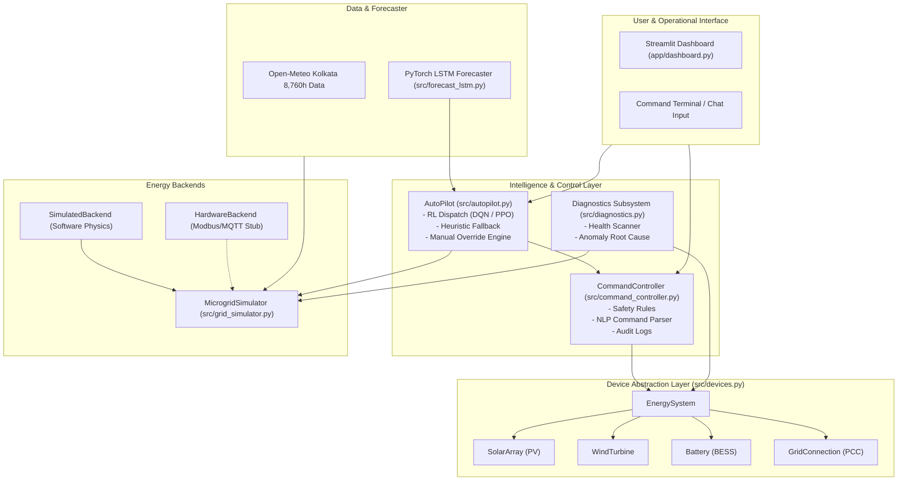
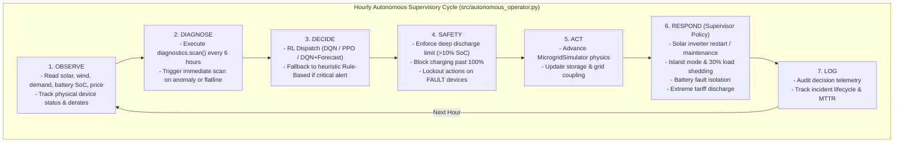

# ⚡ Smart Grid RL Simulator

An autonomous microgrid energy management and optimization platform powered by Reinforcement Learning (DQN, PPO, DQN + Forecast), deep learning solar forecasting (PyTorch LSTM), and heuristic baselines.

The simulator models a campus microgrid equipped with a **100 kW Solar PV Array**, **20 kW Wind Turbine**, **100 kWh Battery Storage (BESS)**, dynamic campus demand, and a point of common coupling (PCC) to the **utility grid**.

---

## 🏗️ System Architecture



---

## 🎛️ Command Center

The dashboard features a **🎛️ Command Center** tab providing real-time telemetry, natural language supervisory control, device actuation, safety interlocks, and diagnostic anomaly detection.

### 1. Supported Commands

The `CommandController` parses case-insensitive natural language instructions with keyword matching:

| Category | Supported Command Syntax | Operational Effect |
| :--- | :--- | :--- |
| **Solar** | `solar on` / `solar off`, `"please switch solar off"` | Enables or disables the solar PV array |
| **Wind** | `wind on` / `wind off`, `"turn off the wind turbine"` | Enables or disables the wind turbine |
| **Battery** | `battery charge` / `battery discharge` / `battery hold` | Commands battery mode (overrides Auto-Pilot for 2 hours) |
| **Grid** | `grid connect` / `grid disconnect` | Switches between grid-tied and island mode |
| **Autonomous** | `auto on` / `auto off` | Toggles autonomous RL dispatch control |
| **Diagnostics** | `scan`, `status` | Executes a comprehensive system diagnostic scan |
| **Maintenance** | `clear fault`, `clear fault solar` | Clears active device faults and restores health |
| **Help** | `help` | Prints the complete command reference |

### 2. Safety Interlocks & Rules

Every command and automatic action passes through the multi-tiered safety layer before physical execution:
- **Battery Deep Discharge Protection**: Discharging is strictly blocked whenever battery State of Charge (SoC) is $\le 10\%$.
- **Overcharge Prevention**: Charging is blocked when battery SoC reaches $100\%$.
- **Fault Device Lockout**: Switching ON or commanding actions on any device in `FAULT` status is refused until the fault is explicitly cleared.
- **Island Mode Warnings**: Disconnecting the main grid when on-site generation and storage cannot guarantee meeting load issues an immediate safety warning.
- **Contradiction Filtering**: Conflicting instructions (e.g. `charge and discharge battery at once` or `turn solar on and off`) are automatically blocked.

### 3. Auto-Pilot Mode & Manual Overrides

- **Autonomous Dispatch**: When Auto-Pilot is enabled, the chosen agent (DQN, PPO, DQN+Forecast, or Rule-Based) continuously observes the microgrid and executes hourly dispatch actions.
- **Temporary Manual Override**: A manual battery directive (`charge`, `discharge`, `hold`) overrides Auto-Pilot for $N$ hours (configurable, default 2 hours). The dashboard clearly displays the remaining override duration, after which Auto-Pilot automatically resumes.
- **Critical Diagnostics Fallback**: If a diagnostic scan detects a `CRITICAL` issue, Auto-Pilot automatically switches to a conservative rule-based fallback and logs the root cause.
- **Missing Model Resilience**: If trained RL weights are absent, Auto-Pilot automatically falls back to the heuristic rule-based strategy with a logged notice.

### 4. Diagnostic Anomaly Detection & Fault Injection

The `scan()` engine inspects telemetry history and device health across 7 failure modes:
1. **Solar Underperformance**: Detects output drops below predicted solar radiation (dust, soiling, or inverter tripping).
2. **Battery Problems**: Identifies frozen SoC, abnormal efficiency degradation ($< 85\%$), or boundary saturation.
3. **Sensor Flatline**: Detects frozen telemetry signals that fail to vary over multiple hours.
4. **Wind Stalling**: Flags wind turbines producing $0\text{ kW}$ during favorable wind speeds ($\ge 4\text{ m/s}$).
5. **Grid Outage**: Reports PCC breaker trips or utility outages.
6. **Campus Demand Spikes**: Alerts on abnormal load surges ($> 85\text{ kW}$).
7. **Unmet Demand Events**: Flags and quantifies unserved load during islanded operation.

The **Fault Injection Sandbox** allows testing faults on demand:
- `solar soiling`: Derates solar generation by 30%.
- `inverter failure`: Drops solar output to 0 kW.
- `battery degradation`: Drops round-trip Coulombic efficiency to 70%.
- `sensor stuck`: Freezes device telemetry.
- `grid outage`: Disconnects grid coupling, placing system in island mode.

---

## 🧠 Reinforcement Learning Formulation

### Observation Space (State)
At hour $t$, the agent receives a normalized vector in $[0.0, 1.0]$:
1. $\text{Solar Generation} / 100\text{ kW}$
2. $\text{Wind Generation} / 20\text{ kW}$
3. $\text{Campus Demand} / 100\text{ kW}$
4. $\text{Battery State of Charge} \in [0.0, 1.0]$
5. $\text{Grid Electricity Price} / 10\text{ ₹/kWh}$
6. Cyclical Hour Sine: $(\sin(2\pi h / 24) + 1) / 2$
7. Cyclical Hour Cosine: $(\cos(2\pi h / 24) + 1) / 2$
8. Day of Week: $\text{DoW} / 6$
9. Peak Hour Indicator: $1.0$ if $18 \le h < 22$, else $0.0$
10. *(Forecast Variant)* 3-Hour Lookahead Predicted Solar ($\text{norm}$)
11. *(Forecast Variant)* 6-Hour Lookahead Predicted Solar ($\text{norm}$)

### Action Space (Discrete)
- **0: CHARGE** — Store surplus renewables; import off-peak grid energy if needed.
- **1: DISCHARGE** — Supply campus load from battery to avoid high grid tariffs.
- **2: BUY** — Import power directly from grid to meet load; conserve battery reserves.
- **3: SELL** — Export surplus renewable clean energy to the grid at ₹3/kWh feed-in tariff.

### Reward Function
$$\text{Reward} = - \left( w_{\text{cost}} \cdot \text{Cost}_{\text{INR}} + w_{\text{co2}} \cdot \text{CO}_{2,\text{kg}} + w_{\text{unmet}} \cdot \text{Unmet}_{\text{kWh}} \right) - \text{Penalty}_{\text{invalid}}$$

---

## 🤖 Autonomous Supervisory Operations

The simulator features a fully autonomous, closed-loop supervisory management system (`src/autonomous_operator.py`) that operates virtual campus microgrids without human intervention.

### 1. Control Loop Architecture

Every simulated hour, the `AutonomousOperator` executes a synchronized 7-phase control cycle:



### 2. Division of Responsibility: RL Agent vs. Rule-Based Supervisor

| Responsibility Area | Controlled by **RL Agent** (DQN / PPO / DQN+Forecast) | Governed by **Rule-Based Supervisor** |
| :--- | :--- | :--- |
| **Nominal Energy Balance** | **Yes** — Learns optimal hourly storage dispatch (charge/discharge/buy/sell) to minimize operational cost and carbon emissions. | Observes passively without intervening unless safety thresholds are breached. |
| **Peak-Shaving & Arbitrage** | **Yes** — Anticipates high-tariff intervals and charges from clean off-peak solar/wind to shave peak grid import. | Intervenes only during extreme tariff spikes (> ₹15/kWh) to prioritize emergency discharge. |
| **Future Lookahead** | **Yes** — The `DQN+Forecast` agent consumes 3h and 6h ahead solar predictions from a PyTorch LSTM. | None — Operates on instantaneous physical telemetry and diagnostic scan alerts. |
| **Grid Outages & Islanding** | Dispatches standard actions without awareness of utility disconnection. | **Yes** — Enforces island mode, prioritizes battery for critical load, and triggers **30% non-critical load shedding** when battery SoC $\le 15\%$. |
| **Solar Inverter Trips** | Sees 0 kW generation and continues dispatch. | **Yes** — Logs lost solar generation, attempts automated reboot after 3 hours, and marks for maintenance if the fault persists past 6 hours. |
| **Battery Fault Isolation** | Actions may be blocked by safety interlock. | **Yes** — Detects BMS/thermal faults, bypasses battery entirely, and safely routes campus demand to grid import. |
| **Critical Scan Interlock** | Switched off during critical alerts. | **Yes** — Automatically falls back to conservative rule-based heuristics upon critical scan alerts until the root cause is resolved. |

### 3. Scenario Presets (`src/scenarios.py`)

The `ScenarioEngine` generates reproducible failure timelines via random seeds:

- **Normal week**: 168 hours of typical weather and minor events (e.g. 8-hour cloudy spell, 4-hour evening tariff spike).
- **Stress test**: Compounding, overlapping physical disruptions:
  - 48-hour heatwave (+25% campus demand)
  - 18-hour overcast monsoon spell (solar output reduced to 30%)
  - 6-hour utility grid blackout (island mode during heatwave)
  - 12-hour wind turbine mechanical trip (0 kW wind)
  - 36-hour thermal battery degradation (efficiency drops to 70%)
  - 4-hour electricity tariff price spike (2x peak rate)
- **Grid outage drill**: Resilience stress drill featuring an extended 8-hour blackout during peak summer heatwave.
- **Random**: Deterministically seeded stochastic timeline drawing random event combinations and durations.

### 4. Benchmark Results Across Scenarios (168 Hours, Seed 42)

| Scenario Preset | Strategy | Cost (₹) | CO₂ (kg) | Unmet Demand (kWh) | Handled Incidents | % Saved vs Grid Only |
| :--- | :--- | :--- | :--- | :--- | :--- | :--- |
| **Normal week** | Grid Only | ₹19,607.70 | 2,350.1 kg | 0.0 kWh | 0 / 0 | 0.00% |
| | Rule-Based | ₹16,742.59 | 2,158.9 kg | 0.0 kWh | 1 / 1 Resolved | **14.61%** |
| | **Autonomous (DQN)** | ₹17,472.44 | 2,164.8 kg | 0.0 kWh | 30 / 30 Resolved | **10.89%** |
| | **Autonomous (DQN+Forecast)** | ₹17,666.39 | 2,164.8 kg | 0.0 kWh | 30 / 30 Resolved | **9.90%** |
| **Stress test** | Grid Only | ₹18,934.38 | 2,408.5 kg | 208.2 kWh | 0 / 0 | 0.00% |
| | Rule-Based | ₹17,617.32 | 2,386.9 kg | 140.9 kWh | 9 / 9 Resolved | **6.96%** |
| | **Autonomous (DQN)** | ₹17,729.60 | 2,352.2 kg | 145.8 kWh | 28 / 28 Resolved | **6.36%** |
| | **Autonomous (DQN+Forecast)** | ₹17,687.60 | 2,352.2 kg | 145.8 kWh | 28 / 28 Resolved | **6.58%** |
| **Grid outage drill** | Grid Only | ₹18,116.21 | 2,266.2 kg | 165.7 kWh | 0 / 0 | 0.00% |
| | Rule-Based | ₹16,672.33 | 2,273.1 kg | 82.6 kWh | 6 / 6 Resolved | **7.97%** |
| | **Autonomous (DQN)** | ₹17,011.54 | 2,254.0 kg | 113.9 kWh | 24 / 24 Resolved | **6.10%** |
| | **Autonomous (DQN+Forecast)** | ₹17,233.99 | 2,254.0 kg | 113.9 kWh | 24 / 24 Resolved | **4.87%** |

---

## ⚠️ Limitations & Hardware Note

> [!IMPORTANT]
> **Simulated Environment Notice**:
> - All microgrid physical components (PV arrays, wind turbine aerodynamics, lithium-ion BESS chemistry, and grid PCC) are simulated in software through `MicrogridSimulator`.
> - **Simulated Failure Timelines**: All environmental stress events, PV soiling, sensor flatlines, and substation breaker trips are synthetically injected through `ScenarioEngine`.
> - **Heuristic Supervisor Responses**: Fault detection, automated inverter reboot cycles, island-mode battery prioritization, and load shedding heuristics are hand-crafted supervisory rules rather than dynamically proven formal safety guarantees.
> - **Hardware Stub**: The `HardwareBackend` class in `src/devices.py` is an **abstract architectural stub and placeholder**. It raises `NotImplementedError` by design and serves as the integration interface for future physical microgrid hardware (e.g. Modbus TCP/RTU power meters, SunSpec inverters, and MQTT IoT gateways).

---

## 🚀 Getting Started

### 1. Installation
Clone the repository and set up a virtual environment:
```powershell
python -m venv venv
venv\Scripts\activate
python -m pip install -r requirements.txt
```

### 2. Running Unit Tests
Execute the comprehensive pytest test suite (39 unit tests):
```powershell
python -m pytest
```

### 3. Launching the Interactive Dashboard
Start the Streamlit application:
```powershell
python -m streamlit run app/dashboard.py
```
Open **http://localhost:8501** in your browser.

### 4. Running the Full Pipeline
To build datasets, train all RL agents, evaluate, and generate comparison charts:
```powershell
# Fast test run (20,000 steps per agent)
python run_all.py --quick

# Full convergence training
python run_all.py
```
